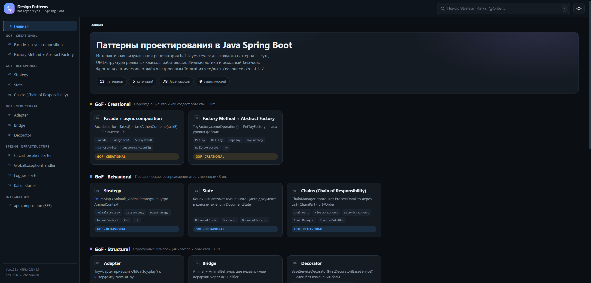
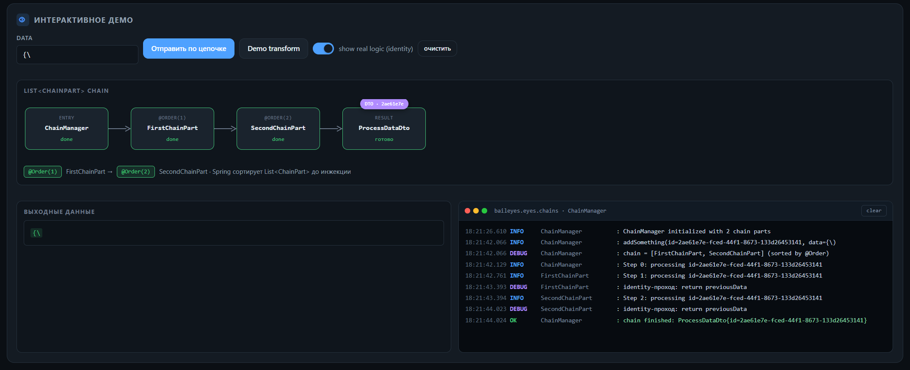
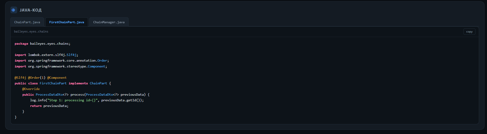
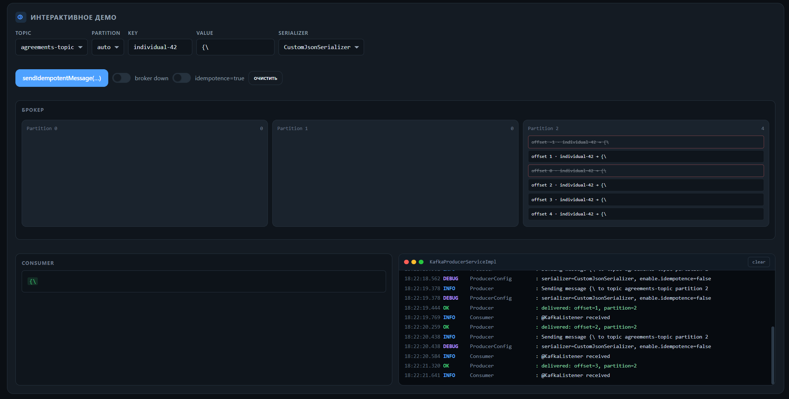

# Design Patterns · baileyes/eyes

Интерактивная визуализация паттернов проектирования (GoF) на **Java Spring Boot** — с живыми JS-демо, UML-структурами и исходным кодом.

[](https://www.oracle.com/java/)
[](https://spring.io/projects/spring-boot)
[](./LICENSE)
[](./src/main/resources/static/)

---

## 📦 Что внутри

| Раздел | Описание |
|--------|----------|
| **13** паттернов | Все 13 паттернов GoF + Spring-инфраструктура |
| **5** категорий | Creational, Structural, Behavioral + Spring Infra + Integration |
| **~100** Java-классов | Реальные реализации, не псевдокод |
| **0** внешних зависимостей | Фронтенд — чистый HTML/CSS/JS, без CDN и сборщиков |

---

## 🚀 Быстрый старт

```bash
# Сборка
./gradlew build

# Запуск (встроенный Tomcat)
java -jar build/patterns-visualization-0.0.1-SNAPSHOT.jar

# Открыть
http://localhost:8080
```

Фронтенд статический — отдаётся встроенным Tomcat из `src/main/resources/static/`.

---

## 🎯 Паттерны

### GoF · Creational (Порождающие)

> *Кто и как создаёт объекты*

| # | Паттерн | Модуль | Описание |
|---|---------|--------|----------|
| 01 | **Strategy** | `Strategy/` | `EnumMap<Animals, AnimalStrategy>` внутри `AnimalContext`. Стратегии: `CatStrategy`, `DogStrategy` |
| 02 | **State** | `State/` | Конечный автомат жизненного цикла документа в константах `enum DocumentState`. Классы: `Document`, `DocumentService` |
| 03 | **Chains** (Chain of Responsibility) | `Chains/` | `ChainManager` прогоняет `ProcessDataDto` через `List<ChainPart>` с сортировкой по `@Order`. Классы: `ChainPart`, `FirstChainPart`, `SecondChainPart`, `ChainManager` |
| 07 | **Facade + async composition** | `Facade/`, `api-composition/` | `Facade.performTasks()` = `taskA.thenCombine(taskB)` — ~2 сек вместо ~4. Классы: `Facade`, `SubsystemA`, `SubsystemB`, `AsyncService` |
| 08 | **Factory Method + Abstract Factory** | `Factory/` | `ToyFactory.someOperation()` + `PetToyFactory` — два уровня фабрик. Продукты: `PetToy`, `BallToy`, `RopeToy`, `DogChewToy`, `CatScratcher` |

### GoF · Structural (Структурные)

> *Композиция классов и объектов*

| # | Паттерн | Модуль | Описание |
|---|---------|--------|----------|
| 04 | **Adapter** | `Adapter/` | `ToyAdapter` приводит `OldCatToy.play()` к интерфейсу `NewCatToy` |
| 05 | **Bridge** | `Bridge/` | `Animal` + `AnimalBehavior`: две независимые иерархии через `@Qualifier` |
| 06 | **Decorator** | `Decorator/` | `BaseServiceDecorator(FirstDecorator(BaseService))` — слои без изменения базы. DTO-декорирование |

### GoF · Behavioral (Поведенческие)

> *Распределение ответственности*

| # | Паттерн | Модуль | Описание |
|---|---------|--------|----------|
| 09 | **Circuit-breaker** (Spring Aspect) | `Circuit-breaker/` | AOP-стартер с аннотацией `@CircuitBreaker`. Конфигурация через `application.yml` |
| 10 | **GlobalExceptionHandler** | `ExceptionHandler/` | Централизованная обработка ошибок через `@RestControllerAdvice`. Иерархия `AppException` |
| 11 | **Logger-starter** | `Logger-starter/` | Цветной логгер с настраиваемыми уровнями, конфиг через `application.yml` |
| 12 | **Kafka-starter** | `Kafka-starter/` | Producer + Consumer с кастомным JSON-сериализатором, автосхема через `.avsc`. Idempotent-отправка |
| 13 | **api-composition (BFF)** | `api-composition/` | Backend-for-Frontend с Feign-клиентами, DTO-трансформацией, `@Qualifier` для бэкингов |

---

## 🖥 Скриншоты

### Главный экран

Общий интерфейс визуализации — навигация по паттернам, категории, карточки с UML-схемами.



### Chains — Интерактивное демо

Визуализация цепочки обработки данных: `ChainManager → FirstChainPart → SecondChainPart → Result`. Порядок шагов определяется `@Order` Spring.



### Chains — Java-код

Реализация `FirstChainPart` с `@Order(1)` — порядок шагов определяется Spring.



### Kafka — Продвинутый режим

Producer → Broker (partitions) → Consumer + live-логи. Переключатели `broker down` / `idempotence`, визуализация партиций и логов `KafkaProducerServiceImpl`.



---

## 🏗 Архитектура проекта

```
Patterns/
├── src/main/
│   ├── java/.../patterns/       # Главный Application
│   └── resources/static/        # Фронтенд (HTML/CSS/JS)
├── Strategy/                    # Strategy
├── State/                       # State
├── Chains/                      # Chain of Responsibility
├── Factory/                     # Factory + Abstract Factory
├── Adapter/                     # Adapter
├── Bridge/                      # Bridge
├── Decorator/                   # Decorator
├── Facade/                      # Facade
├── Circuit-breaker/             # Spring AOP Circuit Breaker
├── ExceptionHandler/            # Global Exception Handler
├── Logger-starter/              # Color Logger Starter
├── Kafka-starter/               # Kafka Producer/Consumer
└── api-composition/             # BFF (Backend-for-Frontend)
```

Каждый паттерн — отдельный Gradle-модуль со своим `*Application.java` и встроенным Tomcat.

---

## 📋 Технологии

| Слой | Стек |
|------|------|
| **Backend** | Java 8, Spring Boot 2.7.18, Spring Web, Lombok, SLF4J |
| **Integration** | Kafka (Confluent Avro schema), Spring Boot Starter |
| **AOP** | Spring AOP (Circuit Breaker, Exception Handler) |
| **Frontend** | Vanilla HTML5, CSS3 (Grid/Flexbox, custom properties), ES6+ |
| **Сборка** | Gradle 8.5 (dual: Gradle + Maven pom.xml) |

---

## 📄 License

[MIT](./LICENSE) © 2026 baileyes/eyes
